# 🛡️ Multi-Cloud DevSecOps & Resilient Microservices Blueprint

Arquitetura de referência para implantação de microsserviços orientados a eventos (**EDA**) com foco em **Shift-Left Security (DevSecOps)**, governança **Multi-Cloud (AWS, Azure, GCP)**, alta disponibilidade e monitoramento contínuo de ameaças via **SIEM/XDR (Wazuh)**.

---

## 🏗️ Arquitetura da Solução

O diagrama abaixo demonstra o fluxo desde o commit do desenvolvedor, passando pelos *Security Gates* automatizados na esteira de CI/CD, até o deploy em infraestrutura isolada e monitorada em tempo real:

```mermaid
%%{init: {'theme': 'base', 'themeVariables': { 'primaryColor': '#1e293b', 'primaryTextColor': '#f8fafc', 'primaryBorderColor': '#475569', 'lineColor': '#38bdf8', 'secondaryColor': '#0f172a', 'tertiaryColor': '#1e293b', 'fontFamily': 'Segoe UI, Roboto, Helvetica, sans-serif'}}}%%

flowchart LR
    %% =====================================================================
    %% 1. CAMADA DE CI/CD & SHIFT-LEFT SECURITY
    %% =====================================================================
    subgraph CICD ["🛡️ 1. Shift-Left CI/CD Pipeline (GitHub Actions)"]
        direction TB
        A(["👨‍💻 Developer Push"]):::dev --> B["🔑 Secret Scan<br/><b>Gitleaks</b>"]:::secGate
        B --> C["🔍 SAST & Code Quality<br/><b>Semgrep / Sonar</b>"]:::secGate
        C --> D["🐳 Multi-Stage Build<br/><b>Docker (Non-Root)</b>"]:::buildNode
        D --> E["🛡️ Container & SCA Scan<br/><b>Trivy (Block High/Crit)</b>"]:::secGate
    end

    %% =====================================================================
    %% 2. CAMADA MULTI-CLOUD & ORQUESTRAÇÃO
    %% =====================================================================
    subgraph CLOUD ["☁️ 2. Multi-Cloud Governance (AWS • Azure • GCP)"]
        direction TB
        F[("📦 Cloud Container Registry<br/><b>AWS ECR | Azure ACR | GCP GAR</b>")]:::cloudNode
        G["⚙️ Container Orchestration<br/><b>Amazon ECS | AKS | GKE</b>"]:::cloudNode
        F ==>|Pull Verified Image| G
    end

    %% =====================================================================
    %% 3. CAMADA DE RUNTIME, MICROSSERVIÇOS & DADOS
    %% =====================================================================
    subgraph VPC ["🔒 3. Private VPC (Runtime & Data Layer)"]
        direction TB
        H["🚀 Microservice API<br/><b>.NET 8 / Java Spring Boot</b>"]:::appNode
        I(("📨 Event Broker<br/><b>RabbitMQ (EDA)</b>")):::dataNode
        J[("🗄️ Relational DB<br/><b>PostgreSQL / AWS RDS</b>")]:::dataNode
        
        H -->|Async Events| I
        H -->|Encrypted TLS| J
    end

    %% =====================================================================
    %% 4. CAMADA DE SECOPS & SIEM / XDR
    %% =====================================================================
    subgraph SECOPS ["👁️ 4. SecOps & Observability (SIEM / XDR)"]
        direction TB
        K["🕵️ <b>Wazuh Agent</b><br/>FIM • CIS Benchmark • Docker"]:::siemNode
        L["🚨 <b>Wazuh SIEM/XDR Manager</b><br/>Threat Hunting & Active Response"]:::siemManager
        K ==>|Encrypted Telemetry| L
    end

    %% =====================================================================
    %% CONEXÕES ENTRE CAMADAS
    %% =====================================================================
    E ==>|"✅ Push Signed Image"| F
    G ==>|"Deploy & Auto-Scaling"| H
    
    G -.->|"Container & Host Logs"| K
    I -.->|"Broker Audit"| K
    J -.->|"DB Audit Logs"| K

    %% =====================================================================
    %% ESTILIZAÇÃO VISUAL (PALETA DARK MODE / CYBERSECURITY)
    %% =====================================================================
    classDef dev fill:#0284c7,stroke:#38bdf8,stroke-width:2px,color:#ffffff,font-weight:bold;
    classDef secGate fill:#881337,stroke:#f43f5e,stroke-width:2px,color:#ffffff;
    classDef buildNode fill:#1e3a8a,stroke:#60a5fa,stroke-width:2px,color:#ffffff;
    classDef cloudNode fill:#78350f,stroke:#f59e0b,stroke-width:2px,color:#ffffff;
    classDef appNode fill:#065f46,stroke:#34d399,stroke-width:2px,color:#ffffff;
    classDef dataNode fill:#312e81,stroke:#818cf8,stroke-width:2px,color:#ffffff;
    classDef siemNode fill:#0f766e,stroke:#2dd4bf,stroke-width:2px,color:#ffffff;
    classDef siemManager fill:#4c1d95,stroke:#c084fc,stroke-width:3px,color:#ffffff,font-weight:bold;

    style CICD fill:#0f172a,stroke:#f43f5e,stroke-width:2px,color:#f8fafc
    style CLOUD fill:#0f172a,stroke:#f59e0b,stroke-width:2px,color:#f8fafc
    style VPC fill:#0f172a,stroke:#34d399,stroke-width:2px,color:#f8fafc
    style SECOPS fill:#0f172a,stroke:#c084fc,stroke-width:2px,color:#f8fafc
```

🚀 Pilares Técnicos e Entregas
1. Esteira DevSecOps Automatizada (Shift-Left)
    Secret Detection: Bloqueio preventivo de credenciais, chaves de API ou certificados expostos no código com Gitleaks.
    SAST (Static Application Security Testing): Análise estática de vulnerabilidades no código-fonte (OWASP Top 10) com Semgrep.
    SCA & Container Hardening: Imagens construídas em Multi-Stage Build, rodando com usuário sem privilégios (non-root), validadas contra CVEs críticas via Trivy antes do envio ao          registry (Amazon ECR / Azure ACR / GCP Artifact Registry).

2. Resiliência, Mensageria e Persistência
    Event-Driven Architecture (EDA): Desacoplamento de serviços utilizando RabbitMQ com filas duráveis e Dead Letter Exchanges (DLX) para absorção de picos de carga.
    Camada de Dados Segura: Persistência em PostgreSQL (compatível com Amazon RDS), operando em sub-rede privada com conexões criptografadas.

3. Monitoramento Contínuo & SIEM/XDR (Wazuh)
    FIM (File Integrity Monitoring): Monitoramento em tempo real de alterações em diretórios críticos do sistema e binários.
    Container Security: Coleta de eventos do daemon do Docker e auditoria de containers em execução.
    Conformidade: Validação contínua baseada nos controles do CIS Benchmark.

📊 Impacto e Métricas Alcançadas    
    -30% no MTTR (Mean Time to Resolution): Redução no tempo de resposta e resolução de incidentes através de esteiras resilientes, healthchecks automatizados e centralização de logs        no SIEM.

100% de Bloqueio de CVEs Críticas pré-deploy: Nenhuma imagem sobe para produção sem passar pelos Quality & Security Gates do pipeline.

🛠️ Como Executar Localmente
    Clone o repositório:

    git clone [https://github.com/Wesnnen/multicloud-devsecops-blueprint.git](https://github.com/Wesnnen/multicloud-devsecops-blueprint.git)
    cd multicloud-devsecops-blueprint

Crie um arquivo .env na raiz (baseado nas variáveis do docker-compose.yml) e execute o script de validação e subida segura:

    chmod +x scripts/hardening-deploy.sh
    ./scripts/hardening-deploy.sh

👨‍💻 Autor    
Wesnnen Silva    
Engenheiro DevOps, DevSecOps & Full-Stack | Bacharel em Ciência da Computação | Pós-graduando em Arquitetura de Software, Ciência de Dados e Cybersecurity (PUCRS)

📧 contato@wesnnen.dev.br    
🔗 [LinkedIn](linkedin.com/in/wesnnen-dev)
